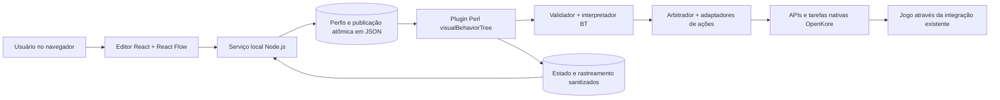
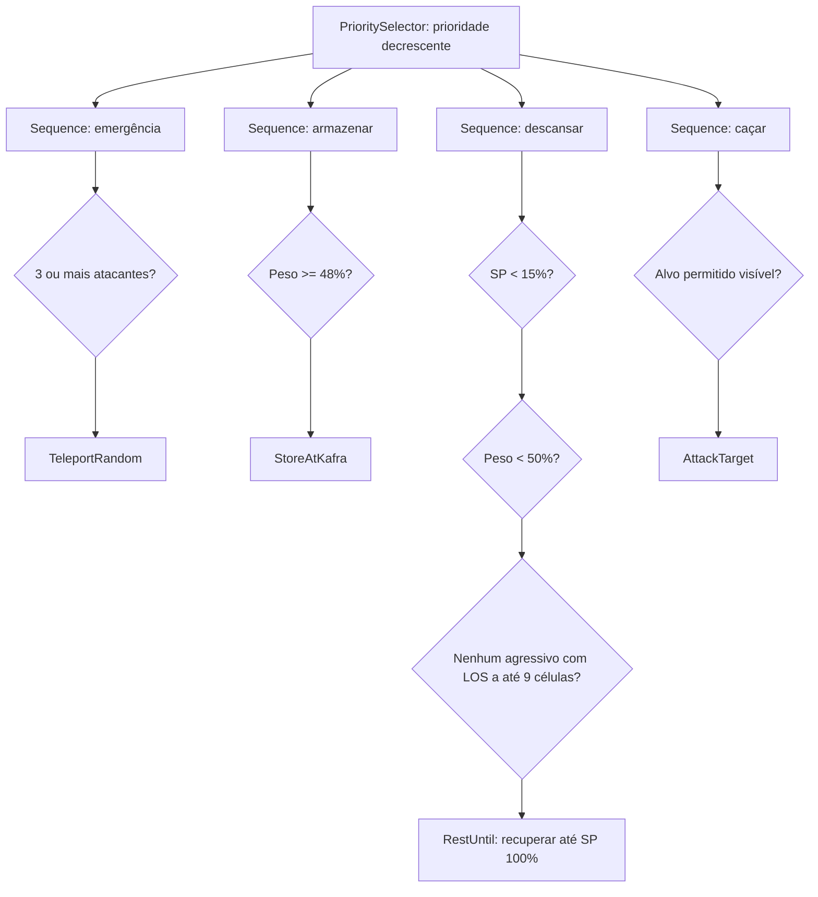

# OpenKore Visual Behavior Tree — Especificação técnica de implementação

**Identificador:** OK-VBT-001  
**Versão da especificação:** 1.0  
**Data:** 20 de outubro de 2026  
**Status:** proposta pronta para implementação incremental, sujeita aos critérios de aceitação  
**Repositório de referência examinado:** `OpenKore-upstream`, branch `fix/handle-zc-move-item-failed`, commit `3a707ded0` (estado consultado nesta data)  
**Idioma primário da interface:** português brasileiro, com arquitetura de internacionalização  
**Plataforma inicial:** Linux/Bazzite, Perl/OpenKore existente, navegador moderno. Suporte a Windows planejado sem dependência de APIs Linux.

> **Regra arquitetural:** não modificar `src/` do OpenKore. Implementar motor, integração e regras em `plugins/visualBehaviorTree/`, perfis em `control/behaviorTree/` e a interface como aplicativo web local opcional. Qualquer limitação que exija alteração no núcleo deverá ser documentada e **não** contornada por monkey-patching indiscriminado.

---

## 1. Visão do produto

O OpenKore configura grande parte do comportamento por entradas textuais em `config.txt`, `mon_control.txt`, `items_control.txt`, `timeouts.txt` e arquivos de macros/plugins. Esse modelo é flexível, mas dificulta compreender a precedência entre comportamentos, diagnosticar inatividade, antecipar conflitos e criar regras condicionais. O produto proposto oferece um **editor visual de Behavior Trees (BT)** com execução real no OpenKore, diagnóstico ao vivo, validação antes de publicar e migração progressiva dos arquivos de configuração existentes.

### 1.1 Objetivo principal

Permitir que uma pessoa configure, visualize, execute e depure comportamentos da IA arrastando nós e conectando-os em uma árvore, com linguagem compreensível: **"Se o peso atingir 48%, vá à Kafra; se houver três atacantes, teleporte; se precisar recuperar SP, sente apenas quando for seguro"**.

O produto não é apenas um editor de fluxogramas: deve possuir um executor de BT com semântica determinística e integração com as ações assíncronas reais do OpenKore.

### 1.2 Resultados mensuráveis

1. Criar e publicar uma árvore simples de combate/armazenamento/descanso sem editar Perl ou arquivos de configuração manualmente.
2. Inspecionar o nó ativo, sua condição, o motivo de falha e a ação atualmente aguardando conclusão.
3. Preservar os comportamentos legados quando o plugin está desativado; quando ativado, evitar duas automações controlarem a mesma ação.
4. Desligar o editor web e manter a árvore ativa no OpenKore.
5. Rejeitar árvores inválidas antes de ativá-las e permitir rollback instantâneo para a última versão válida.
6. Confirmar por testes que `plugin reload all`, reconexão, morte e troca de mapa não duplicam hooks nem deixam a IA presa.

### 1.3 Público e experiência inicial

O usuário principal conhece tarefas de Ragnarok, mas não precisa conhecer `AI::queue`, IDs de pacotes ou sintaxe Perl. O primeiro acesso abre um assistente com um perfil **"Caçar, recuperar e armazenar"**, já estruturado e editável. O painel de propriedades fornece rótulos e ajuda contextual; campos como **peso**, **SP**, **distância**, **quantidade de atacantes** e **item** possuem unidades, limites e validação.

### 1.4 Escopo da primeira versão (MVP)

**Incluído:** editor visual; perfis versionados; árvore com prioridade e ações assíncronas; condições de personagem/monstros/inventário/mapa; ações de sentar, levantar, mover, atacar, usar skill/item, teleporte e armazenar na Kafra; modo somente-observação; modo assistido e modo gerenciado delimitado; monitoramento; simulação por snapshots; importação parcial e não destrutiva de configurações; validação e rollback.

**Excluído do MVP:** conversão integral e perfeita de qualquer macro arbitrária; nós com código Perl/JavaScript livre; controle paralelo real de múltiplas ações de jogo; compartilhamento de árvores em nuvem; editor gráfico dentro da interface Wx; controle simultâneo de vários personagens; substituição de todos os subsistemas nativos ou de todos os plugins de terceiros.

---

## 2. Achados concretos no OpenKore examinado

| Componente | Evidência no repositório | Implicação para o design |
|---|---|---|
| Loop principal | `src/functions.pl`: hooks `mainLoop_pre` e `mainLoop_post` | Ler publicações e alimentar telemetria sem depender de o personagem estar logado. |
| IA automática | `src/AI/CoreLogic.pm`: hooks `AI_pre`, `AI_middle`, `AI_post` | Executar ticks somente no modo automático e arbitrar decisões sem bloquear o loop. |
| IA manual | `src/AI/CoreLogic.pm`: hook `AI_pre/manual` | Não assumir que `AI_pre` sempre roda; respeitar controle manual e tarefas nativas em andamento. |
| Ciclo dos plugins | `src/Plugins.pm`: `register`, `addHooks`, `delHooks`, `reload` | Instalar/desinstalar hooks com segurança e evitar callbacks duplicados. |
| Comandos | `src/Commands.pm`: `register`/`unregister` | Expor `bt status`, `bt pause`, `bt resume`, `bt reload`, `bt rollback`, etc. |
| Ações existentes | `src/AI.pm`, `src/Actor.pm`, `src/Actor/You.pm` | Adaptar ações já suportadas, em vez de enviar pacotes diretamente. |
| Teleporte | `src/Task/Teleport/Random.pm` e `Respawn.pm`, `Misc::getFlyWing/getButterflyWing` | Reutilizar seleção de itens e fallback existentes. |
| Autoarmazenamento | `src/AI.pm::shouldStartAutoStorage`, `src/AI/CoreLogic.pm::processAutoStorage` | Delegar a rotina nativa de Kafra, sem reproduzir diálogos NPC. |
| Configuração | `src/Misc.pm::configModify` chama `saveConfigFile()` | **Não usar `configModify` para overrides temporários:** ele grava o `config.txt`. |
| Servidor web embutido | `src/Base/WebServer.pm` implementa somente requisições GET | Interface com gravação deve usar serviço web próprio; não expor mutações por GET. |
| Dependências do ambiente | Perl com `JSON::PP` e `IO::Socket::INET`; Node e npm disponíveis na máquina examinada | Executor pode ser Perl puro; Node necessário apenas ao abrir o editor. |

**Limitação fundamental:** `AI_pre` não substitui sozinho a lógica nativa. O loop chama funções de ataque, armazenamento, rotas e buffs independentemente. Portanto, o modo gerenciado precisa declarar quais **domínios de comportamento** assume e aplicar uma política de exclusividade, sem desabilitar proteções de emergência do usuário.

**Descoberta importante sobre ataque:** neste OpenKore, `attackAuto 0` ainda permite reação a ataques. Para impedir decisões de ataque automático **dentro de um domínio explicitamente controlado**, o valor correto é `-1`, considerando também variantes por contexto de mapa/rota. O plugin continuará podendo iniciar um ataque explícito via `$char->attack($targetID)`; isso deve ser demonstrado por teste de integração antes de liberar o domínio.

---

## 3. Arquitetura proposta



### 3.1 Componentes

1. **Editor web:** React, TypeScript, Vite e `@xyflow/react` (React Flow). Oferece canvas, paleta, formulários, validação visual e execução destacada. Dependências fixadas em `package-lock.json` na implementação, não em versões flutuantes.
2. **Serviço local do editor:** Node.js, ouvindo apenas `127.0.0.1`, com API REST, autenticação de sessão e persistência segura. Ele não executa a IA nem envia ações ao jogo. Não é necessário enquanto a árvore funciona sem editor aberto.
3. **Plugin OpenKore:** Perl com `strict`, `warnings`, `JSON::PP`, módulos já distribuídos pelo OpenKore e, quando preciso, módulos core. Carrega/valida publicações e executa ticks.
4. **Motor BT puro:** operações de compilação/validação, controle de fluxo e gerenciamento de estado por nó, separadas dos adaptadores de OpenKore para testes sem conexão ao jogo.
5. **Adaptadores de ações:** encapsulam APIs nativas de ataque, movimento, sentar, skills, itens, teleporte e armazenamento, retornando estados assíncronos.
6. **Canal de publicação/telemetria:** arquivos JSON locais atualizados por `write-temp + fsync + rename` no mesmo sistema de arquivos. Evita rede entre processos, dependência de WebSocket e bibliotecas Perl extras.

### 3.2 Por que arquivos para comunicação entre editor e plugin?

A árvore funciona mesmo se Node ou o navegador encerrarem; o serviço pode ser reiniciado sem afetar a sessão; e a entrega de um perfil passa a ser um evento **transacional** facilmente testável. Como as publicações são raras e a telemetria é moderada, a latência de arquivos locais é suficiente. Não usar polling de disco em toda iteração da IA: frequência e detecção de alterações são limitadas.

### 3.3 Princípios mandatórios

- Nenhuma modificação em `src/` na primeira versão.
- Nenhuma alteração automática de `control/config.txt`, `mon_control.txt`, `items_control.txt` ou macros durante a ativação/desativação. Importações são somente leitura.
- **Um único despachante de ações de jogo** por árvore/instância; nenhuma folha envia ação sem o arbitrador.
- Hooks e comandos são removidos no unload; não é aceitável depender de reiniciar o OpenKore para liberar estado.
- Estado de runtime é distinto do grafo editável: nunca salvar IDs efêmeros de atores, tarefas, sessão ou ponteiros dentro do perfil.
- Falhas de validação, leitura ou implementação de ação não substituem a última publicação válida.
- Nenhum `eval` de texto do usuário nem execução arbitrária de comandos do sistema ou scripts do OpenKore.

---

## 4. Modos de execução e compatibilidade

### 4.1 Modos

| Modo | O que faz | Padrão |
|---|---|---|
| **Observação (shadow)** | Avalia condições e mostra qual ramo venceria; não envia ações nem altera configuração em memória. | **Padrão inicial obrigatório.** |
| **Assistido (assist)** | Executa apenas ações cujo domínio esteja explicitamente delegado e livre; demais decisões continuam nativas. Ao detectar conflito, recusa ação com diagnóstico. | Opcional, confirmado no editor. |
| **Gerenciado (managed)** | Controla os domínios selecionados; aplica overrides **somente em memória** para impedir que o OpenKore nativo execute rotinas concorrentes nesses domínios. | Exige pré-visualização de conflitos, confirmação e testes. |

### 4.2 Domínios de autoridade

São domínios independentes: `combat`, `movement`, `rest`, `self_skills`, `items`, `storage` e `teleport_strategy`. Há também o domínio especial **`emergency`**, sempre mantido com as salvaguardas nativas, nunca transferido automaticamente.

Cada nó de ação declara `domain` no catálogo. Uma árvore em modo managed declara `managedDomains`; o validador rejeita ações incompatíveis com os domínios selecionados. Dois perfis não podem assumir simultaneamente o mesmo domínio numa instância.

**Overrides em memória, aplicados somente com validação e sem `configModify`:**

| Domínio assumido | Supressão nativa proposta | Precaução |
|---|---|---|
| `combat` | `attackAuto = -1`, incluindo modos contextuais aplicáveis (`attackAuto_routeToLock`, `attackAuto_outOfLock`, `attackAuto_inLockOnly`) | Testar que o ataque explícito iniciado por `$char->attack` continua funcionando. Não suprimir defesa de emergência configurada pelo usuário. |
| `movement` | `route_randomWalk = 0` | O tratamento de `lockMap`, reconexão e trajetos para Kafra continua delegado à navegação nativa quando necessário; evitar rotas simultâneas. |
| `rest` | `sitAuto_hp_lower = 0`, `sitAuto_sp_lower = 0`, `sitAuto_idle = 0` | Não cancelar sentar manual sem confirmação. `rest` gerencia sentar/levantar e estados assíncronos. |
| `self_skills` | Marcar em memória `_disabled = 1` para as entradas `useSelf_skill_N` capturadas no momento da ativação | Não afetar `attackSkillSlot` automaticamente; avisar sobre plugins que enviam buffs fora do mecanismo nativo. |
| `items` | Desabilitar em memória as entradas `useSelf_item_N` assumidas | Preservar consumíveis de emergência não delegados. |
| `storage` | `storageAuto = 0` para decisão automática; o nó BT pode enfileirar a tarefa nativa `storageAuto` | Provar em integração que o processamento da tarefa prossegue mesmo com essa opção desativada. |
| `teleport_strategy` | Suspender somente triggers não emergenciais explicitamente migrados | Não desativar `teleportAuto_hp`, fuga por monstros perigosos ou outras proteções por padrão. |

**Implementação dos overrides:** capturar valor original, presença da chave e valor aplicado; modificar `%config` em memória diretamente; revalidar alterações externas. No descarregamento, restaurar **apenas se o valor atual ainda for o override do plugin**. Eventos `pos_load_config.txt` e `post_configModify` disparam reconciliação: se o usuário alterou a configuração durante o modo gerenciado, informar o conflito e pausar o domínio, em vez de sobrescrever silenciosamente. Nenhum segredo do `config.txt` é exportado para o navegador.

O comportamento exato de cada override deve ser verificado contra o código real do commit-alvo antes de a UI oferecer a opção. Domínios com integração não comprovada permanecem `shadow`/`assist` até a aprovação de testes.

### 4.3 Política de prioridade e segurança

1. Morte, desconexão, troca de mapa, teleporte emergencial, tarefas NPC críticas e pausas manuais têm precedência sobre a BT.
2. Publicações novas não podem cancelar silenciosamente tarefas nativas já em progresso.
3. A BT pode interromper **suas próprias** ações quando uma condição de prioridade superior se torna verdadeira.
4. Não usar `AI::clear()` genérico para "limpar tudo". Cancelar apenas tarefas identificadas como criadas pelo plugin; se não houver propriedade demonstrável, marcar `HALT_PENDING` e aguardar um ponto seguro.
5. Se ocorrer conflito inesperado de propriedade, falhar de forma conservadora: suspender despacho, registrar o diagnóstico e deixar as proteções nativas ativas.

---

## 5. Modelo formal da Behavior Tree

### 5.1 Estados

O motor emprega `IDLE`, `RUNNING`, `SUCCESS`, `FAILURE` e `ERROR`. `ERROR` indica entrada/sensor inválido, exceção, regra incompatível ou falha de invariantes; **não pode ser convertido em `SUCCESS` por um Inverter**. No MVP, qualquer `ERROR` propaga até a raiz, não despacha novas ações e gera uma falha diagnosticável. Folhas condicionais não retornam `RUNNING`.

**Nota de terminologia:** `HALTED` é estado do ciclo de vida/telemetria, não resultado comum retornado pelos nós. `HALT_PENDING` pertence aos adaptadores de ações cujo cancelamento precisa ser confirmado.

### 5.2 Nós de controle

| Tipo | Filhos | Semântica exata |
|---|---:|---|
| `PrioritySelector` | 1–N | Em cada tick, reavalia desde o primeiro filho (maior prioridade). Primeiro `SUCCESS` ou `RUNNING` vence; se houver um novo vencedor, tenta parar o ramo anterior. Retorna `FAILURE` se todos falham. |
| `Sequence` | 1–N | Executa filhos na ordem; mantém o índice do filho `RUNNING`. Continua após `SUCCESS`, para em `FAILURE`/`ERROR`; reinicia após conclusão. Reavalia condições guardas quando reentrar após preempção. |
| `Fallback` | 1–N | Tenta filhos na ordem até encontrar `SUCCESS`/`RUNNING`; preserva filho em andamento sem reavaliar irmãos anteriores, diferentemente de `PrioritySelector`. |
| `Inverter` | 1 | Inverte apenas `SUCCESS` e `FAILURE`; preserva `RUNNING` e `ERROR`. |
| `Cooldown` | 1 | Ao `SUCCESS`, registra timestamp monotônico; enquanto a janela não termina, retorna `FAILURE`; `RUNNING` não reinicia o prazo. |
| `Timeout` | 1 | Se o filho permanecer `RUNNING` além do prazo, solicita `halt`, retorna `FAILURE` após confirmação; não abandona tarefa não cancelável. |
| `Retry` | 1 | Repete somente em `FAILURE`, até N tentativas; aplica intervalo mínimo de espera e limite total. Proibidos retries infinitos no MVP. |
| `AlwaysSucceed` | 1 | Converte apenas `FAILURE` em `SUCCESS`, sem ocultar `ERROR`. |

A ordem de execução **é `children[]`**, não posição X/Y dos cartões no canvas. O editor oferece reordenação explícita por setas/drag handle. Um nó composto não pode possuir menos filhos que seu mínimo nem exceder seu máximo.

### 5.3 Contrato do tick

```text
onTick(snapshot, now):
  se o plugin está pausado ou em shadow, não despachar ações
  consultar a raiz com snapshot imutável do ciclo
  permitir várias condições síncronas, mas no máximo 1 nova ação externa por tick
  propagar RUNNING enquanto qualquer ação estiver pendente
  registrar transições e motivos; não registrar a mesma condição a cada tick
  executar HALT somente para ações de propriedade comprovada
```

- Avaliação a até **10 Hz**, sem `sleep` bloqueante; chamada a partir de `AI_pre` quando `AI::state() == AUTO` e dentro do jogo.
- Processamento de publicações, sinais de vida e telemetria em `mainLoop_pre`, mesmo fora do jogo, a frequência limitada.
- Tick usa snapshot coerente por ciclo: mapa, posição, peso, HP, SP, status, inventário, monstros visíveis, agressividade observada e fila de tarefas. Se o dado necessário estiver indisponível, retornar `ERROR` com causa, não inferir um valor.
- Limitar árvore a **200 nós, profundidade 20, até 1 despache de ação por tick** no MVP; valores revisáveis mediante benchmark.
- Folhas assíncronas persistem `operationId`, deadline, domínio, alvo validado, evidência de progresso e última observação em runtime, nunca no JSON salvo.
- Se houver mudança de mapa, perda de ator, morte, desconexão ou reload, invalidar operações efêmeras de forma segura e retomar somente quando as pré-condições forem válidas.

### 5.4 Blackboard (somente execução)

Campos de leitura: `character.hpPercent`, `spPercent`, `weightPercent`, `isSitting`, `isDead`, `map`, `position`, `statusFlags`, `inventory[itemID].amount`, `monstersVisible[]` e `ai.currentAction`.

Valores de contexto escritos apenas pelo runtime: `targetActorId`, `targetNameId`, `operationId`, `lastActionResult`, `lastError`, `activationRevision`. Qualquer referência a alvo precisa ser validada novamente antes do despacho. Um ator que desapareceu ou cujo ID foi reciclado nunca pode ser usado com base num snapshot anterior.

---

## 6. Catálogo de nós do MVP

Cada tipo possui: `typeId`, `category`, `label`, `description`, `inputSchema`, `defaultParameters`, `ports`, `domain`, `requiredCapabilities`, `version`, `safeInShadow` e lógica do motor. O editor e o runtime devem obter o catálogo de **uma fonte de verdade versionada**, com tipos e schemas compartilhados por geração; jamais manter uma lista independente de nomes hardcoded em React.

### 6.1 Condições (sem efeitos colaterais)

| ID | Propriedades | Resultado `SUCCESS` |
|---|---|---|
| `CharacterHp` | `operator`, `percent` | HP satisfaz condição. |
| `CharacterSp` | `operator`, `percent` | SP satisfaz condição. |
| `WeightPercent` | `operator`, `percent` | Peso satisfaz condição, inclusive `>= 48`. |
| `InMap` | `mapName` ou `lockMap` | Personagem está no mapa. |
| `IsSitting` | `expected` | Estado de sentar coincide. |
| `StatusEffect` | `statusId`, `active` | Buff/debuff corresponde. |
| `InventoryCount` | `itemId`, `operator`, `count` | Quantidade em inventário satisfaz condição. |
| `MonsterNearby` | `monsterIds?`, `distance`, `requireLOS`, `count` | Há monstros correspondentes dentro do alcance. |
| `AggressivesNearby` | `count`, `distance?`, `requireLOS`, `definition` | Quantidade satisfaz regra; `definition` diferencia agressividade de tabela, hostilidade observada e ataques ao personagem. |
| `CanAccessStorage` | — | Pré-condições nativas para abrir a Kafra estão disponíveis. |
| `HasSkill` | `skillHandle`, `level` | Personagem possui nível suficiente. |
| `ActionIdle` | `domain?` | Não existe operação conflitante em curso. |

**Agressividade não é sinônimo de atacante simultâneo.** A interface deve mostrar a definição escolhida. `attackingMe` utiliza evidência de alvo/dano/cast; `monsterTypeAggressive` usa tabela; `either` aceita qualquer uma. Distância usa `blockDistance` e LOS usa `$field->checkLOS`, com fallback conservador quando geometria ausente.

### 6.2 Ações

| ID | Parâmetros | Execução/sucesso | Domínio |
|---|---|---|---|
| `Stand` | `timeoutMs` | Enfileira levantar; sucesso com confirmação de personagem em pé. | `rest` |
| `RestUntil` | `hpAtLeast`, `spAtLeast`, `maxWeight`, `noAggressiveWithin`, `requireLOS`, `maxDurationMs` | Senta se seguro, acompanha recuperação, levanta ao atingir limiares. Falha se peso/ameaça impedirem descanso. | `rest` |
| `MoveTo` | `map`, `x`, `y`, `radius`, `timeoutMs` | Usa `$char->route`; sucesso quando posição confirmada dentro do raio. | `movement` |
| `MoveOneTile` | `direction=auto`, `timeoutMs`, `retryLimit` | Busca célula caminhável e confirma deslocamento. Útil após skill que exige passo. | `movement` |
| `AttackTarget` | `monsterIds`, `selection=nearest`, `timeoutMs`, `maxDistance` | Seleciona ator válido, usa `$char->attack`, aguarda morte/desaparecimento/resultado. | `combat` |
| `UseSkill` | `skillHandle`, `level`, `target=self|currentMonster`, `timeoutMs` | Usa API de skills (`ai_skillUse`) e confirma êxito por evidência disponível; falha se skill não existir ou estiver bloqueada. | `self_skills` / `combat` conforme alvo |
| `UseItem` | `itemId`, `target=self`, `timeoutMs` | Usa API de inventário já suportada, com confirmação de consumo/status. | `items` |
| `TeleportRandom` | `timeoutMs` | Usa `ai_useTeleport(1)`, aguarda confirmação de teleporte/troca de posição. | `teleport_strategy` |
| `ReturnToSavePoint` | `timeoutMs` | Usa `ai_useTeleport(2)`, incluindo fallback Novice Butterfly Wing → Butterfly Wing. | `movement` |
| `StoreAtKafra` | `minWeightToTrigger?`, `timeoutMs`, `npc=useNativeConfig` | Se houver itens armazenáveis, enfileira `storageAuto` nativo e espera conclusão + confirmação do peso/itens. | `storage` |
| `Wait` | `durationMs` | `RUNNING` até atingir prazo sem bloquear a IA. | nenhum |
| `Idle` | — | Não despacha ação; termina `RUNNING` enquanto selecionado. | nenhum |

**Condições de êxito rigorosas:** enfileirar a ação não significa que ela deu certo. Exemplo: `MoveOneTile` requer evidência de deslocamento, `StoreAtKafra` exige evento/comprovação de encerramento, e `UseSkill` não pode marcar sucesso somente porque enviou o pedido. Quando o protocolo não oferece confirmação confiável, a ação retorna `FAILURE` por timeout explicitamente, com causa.

**Contenção de comandos:** não incluir `RunShell`, `EvalPerl`, `ExecuteMacro` genérico ou "executar texto arbitrário" no MVP. Plugins e macros de terceiros continuam existentes, mas sua orquestração arbitrária não será anunciada como segura/compatível.

### 6.3 Nó de armazenamento e itens

`StoreAtKafra` **não reimplementa** diálogo com NPC. Ele usa a configuração nativa `storageAuto_npc`, `items_control` e funções/tarefas de armazenamento do OpenKore. O editor exibe se a ação tem Kafra válida, itens aptos a armazenar, zeny/ingressos necessários e configurações em conflito. Se o OpenKore não puder abrir o storage, devolver falha explicável, não insistir em loop.

`InventoryCount` verifica inventário atual; regras de `getAuto`/reposição são importadas como anotação/diagnóstico na primeira versão, com edição visual completa prevista para fase posterior. Não prometer "estoque sempre entre mínimo e máximo" sem executar a rotina nativa correspondente.

### 6.4 Exemplo visual de fluxo



O exemplo expressa uma política de prioridade, **não uma promessa de que `StoreAtKafra` cancela automaticamente qualquer combate ou teleporte já iniciado**. Preempção depende do domínio e do contrato do adaptador.

---

## 7. Modelo de dados e versionamento

### 7.1 Esquema persistente

Arquivo por perfil: `control/behaviorTree/graphs/<uuid>.json`, codificação UTF-8, JSON estrito. Exemplos de campos obrigatórios:

```json
{
  "schemaVersion": 1,
  "profileId": "c0f2a976-58bf-4fa0-b792-5cc964c88b01",
  "name": "Caça segura — Gonryun",
  "description": "Armazenamento, descanso e combate com prioridade",
  "mode": "shadow",
  "managedDomains": [],
  "rootId": "root",
  "nodes": [
    {
      "id": "root",
      "type": "PrioritySelector",
      "params": {},
      "children": ["store-check", "idle"]
    },
    {
      "id": "store-check",
      "type": "Sequence",
      "params": {},
      "children": ["weight", "store"]
    },
    {
      "id": "weight",
      "type": "WeightPercent",
      "params": {"operator": ">=", "percent": 48},
      "children": []
    },
    {
      "id": "store",
      "type": "StoreAtKafra",
      "params": {"npc": "useNativeConfig", "timeoutMs": 120000},
      "children": []
    },
    {
      "id": "idle",
      "type": "Idle",
      "params": {},
      "children": []
    }
  ],
  "layout": {
    "positions": {
      "root": {"x": 0, "y": 0},
      "store-check": {"x": 150, "y": 120},
      "weight": {"x": 60, "y": 240},
      "store": {"x": 250, "y": 240},
      "idle": {"x": 450, "y": 120}
    },
    "viewport": {"x": 0, "y": 0, "zoom": 1}
  },
  "metadata": {"editorVersion": "1.0.0", "notes": ""}
}
```

`layout` jamais é interpretado pelo executor. O modelo persistido é **árvore dirigida**: um único pai para cada nó exceto a raiz; nenhuma aresta extra; sem ciclos ou nós órfãos.

### 7.2 Validação determinística

**Estrutural:** um root; IDs únicos; filhos existentes; sem ciclos; um único pai; limites de nós/profundidade; cardinalidade de filhos; somente `schemaVersion` suportada; tamanho máximo do documento **256 KiB**.

**Semântica:** tipos catalogados; parâmetros completos, tipos exatos e intervalos; percentuais `0..100`; distâncias `0..50`; timeout `100..600000` ms conforme ação; nomes de mapas validados; IDs inteiros de itens/monstros positivos; skills existentes no catálogo atual; domain ownership; eventos de sucesso observáveis; conflitos de configuração e detecção de ausência de ações de fallback.

**Publicação:** validar no frontend para UX, no serviço Node por schema e **novamente no plugin Perl**. Só a validação do plugin autoriza execução. Dados inesperados/unknown fields são rejeitados, exceto `metadata`/`layout` documentados. Migradores explícitos cuidarão de `schemaVersion` futura; nunca converter silenciosamente versões desconhecidas.

### 7.3 Persistência e revisão

```text
control/behaviorTree/
  graphs/<uuid>.json                 # perfis editáveis
  snapshots/<revision>.json          # últimas 10 publicações válidas
  deployments/current.json           # envelope ativo escrito atomicamente
  runtime/status.json                # status sanitizado, escrito pelo plugin
  runtime/events.ndjson              # ring lógico com rotação e limites
```

`current.json` inclui `{deploymentSchemaVersion, revision, createdAt, profile}`. O serviço Node escreve arquivo temporário no mesmo diretório, sincroniza, renomeia e aguarda `runtime/status.json` reconhecer **a revisão exata**. O plugin valida, constrói nova árvore em memória e só troca o objeto ativo em ponto seguro. Em erro, publica `{rejectedRevision, errors}` e mantém a árvore anterior.

A interface fornece histórico, diferenças textuais/visuais, restauração e botão **"Voltar à última versão funcional"**. A revisão ativa nunca é redefinida com base em um grafo ainda não publicado.

### 7.4 Controle de concorrência

Cada salvamento do editor deve enviar `If-Match` com versão/revisão do perfil. Atualizações concorrentes retornam HTTP `409` e oferecem comparação; nunca sobrescrever edição de outra janela silenciosamente. Uma única instalação do OpenKore pode executar **um perfil ativo por instância** no MVP.

---

## 8. UI/UX do editor

### 8.1 Layout

- **Cabeçalho:** instância OpenKore, perfil ativo, estado `Desconectado/Shadow/Pausado/Executando/Erro`, botões Salvar, Validar, Simular, Publicar, Pausar e Rollback.
- **Paleta esquerda:** busca de nós agrupados em `Lógica`, `Condições`, `Combate`, `Movimento`, `Sobrevivência`, `Itens e Kafra`, com descrições em português e exemplos.
- **Canvas central:** React Flow com zoom, pan, minimapa, auto-arranjo, encaixe, portas tipadas, conexões visuais e destaque da linha de execução.
- **Inspetor direito:** formulário gerado a partir do schema, dropdowns para skills/monstros/itens, unidades, limites, ferramenta "Testar condição agora" e mensagens de validação.
- **Painel inferior:** timeline de decisões, resultado por nó, operação pendente, snapshot resumido e avisos de conflito.

### 8.2 Interações essenciais

1. Arrastar nó da paleta; conectar pai a filho.
2. Impedir visualmente ciclos e conexões inválidas; ainda validar no servidor.
3. Reordenar prioridades sem depender de coordenadas geométricas.
4. Duplicar/apagar nós (com confirmação de exclusão de subárvore), desfazer/refazer pelo menos 50 passos.
5. Indicar quando um nó não possui entradas obrigatórias.
6. Exibir **por que** uma condição deu falso: por exemplo, "Peso 47,6%; mínimo 48%" ou "Monstro visível, mas sem linha de visão".
7. Marcar visualmente `RUNNING`, `SUCCESS`, `FAILURE`, `ERROR`, `HALT_PENDING` com ícone/texto e não somente cor.
8. Diferenciar claramente **Salvar rascunho** de **Publicar no bot**.
9. Em modo managed, mostrar o diff de overrides, quais plugins podem conflitar e uma confirmação separada de autoridade.
10. Oferecer modelos editáveis: "Caça básica", "Gunslinger com recuperação de SP", "Farm com Kafra" e "Somente segurança".

### 8.3 Acessibilidade e internacionalização

PT-BR por padrão, chaves de tradução e opção futura de inglês. Nó selecionável por teclado; ordem e propriedades editáveis sem arrastar; contraste AA; informações importantes acessíveis em texto; navegação com foco visível; feedback de erros ao lado do campo.

### 8.4 Diagnóstico e simulador

O simulador aceita (a) snapshots de telemetria sanitizada e (b) cenários fictícios definidos em formulário. Usa o **mesmo interpretador Perl e catálogo de nós da execução real**; o servidor Node inicia somente o comando **fixo e interno** `perl .../bin/simulate.pl` com JSON no stdin, timeout e saída limitada. Não aceita caminho de executável ou comando do usuário. Não envia pacotes ao jogo.

O replay mostra sequência de nós, prioridades, condições, ações que *teriam* sido iniciadas, tempos e erros. Testes de cenário podem ser salvos junto ao perfil, mas fora da parte executável do JSON.

---

## 9. API local e contratos entre processos

### 9.1 Serviço Node (somente loopback)

Porta sugerida `47851`, configurável; se ocupada, falhar com diagnóstico claro ou selecionar outra porta local e apresentar o endereço efetivo. Sem interface escutando em `0.0.0.0` por padrão.

| Método e caminho | Contrato |
|---|---|
| `GET /api/v1/health` | Versão do editor; disponibilidade do diretório de runtime; sem segredos. |
| `GET /api/v1/catalog` | Tipos de nós, schemas, enums e capacidades. |
| `GET /api/v1/profiles` | Lista dos perfis do diretório autorizado. |
| `GET /api/v1/profiles/:id` | Perfil e ETag. |
| `POST /api/v1/profiles` | Criar rascunho validado. |
| `PUT /api/v1/profiles/:id` | Atualizar com `If-Match`. |
| `DELETE /api/v1/profiles/:id` | Excluir apenas perfil inativo, com confirmação. |
| `POST /api/v1/validate` | Validação estrutural/semântica em modo preview. |
| `POST /api/v1/simulate` | Rodar simulador isolado, sem conectar ao jogo. |
| `POST /api/v1/deployments` | Publicar uma revisão do perfil; requer confirmação de modo/domínios. |
| `POST /api/v1/deployments/rollback` | Reativar snapshot anterior como nova revisão. |
| `GET /api/v1/runtime` | Status do plugin, revisão reconhecida e execução corrente. |
| `GET /api/v1/events?after=...` | Eventos sanitizados com paginação; o frontend consulta a cada 500 ms. |

**Ações Pausar/Retomar:** o editor escreve um envelope de controle com `commandId` único, `action=pause|resume`, que o plugin reconhece e confirma. Não habilitar ativação de `managed` por endpoint GET nem via mudança implícita de perfil.

### 9.2 Estado do plugin

`runtime/status.json` inclui, no máximo: `protocolVersion`, `timestamp`, `instanceId` aleatório, `aiState`, `connectionState`, `activeRevision`, `requestedRevision`, `mode`, `managedDomains`, `treeState`, `activeNodeIds`, `currentOperation` (tipo/status sem ID privado), `lastError`, `metrics`, `ackCommandId`, `rejectedRevision` e `validationErrors`. IDs privados, segredos, endereços de servidor, conteúdo de chat e pacotes binários não são enviados.

### 9.3 Frequências, integridade e armazenamento

- Editor: estado a cada 500 ms; eventos com cursor monotônico; backoff exponencial quando offline.
- Plugin: verificar metadados de publicação a cada **250 ms**, no máximo; parse JSON completo somente quando revisão muda; telemetria a cada **500 ms** ou em transição relevante, com debounce.
- Status e publicação por escrita temporária seguida de `rename`; arquivos mantidos dentro da raiz configurada; no máximo 5 MiB de logs recentes, com rotação.
- Arquivos de perfil precisam ter permissões restritas ao usuário (`0600` para dados; diretórios `0700`, quando aplicável), sem seguir symlinks para fora da raiz.
- Erro de escrita da telemetria nunca derruba o cliente nem bloqueia o loop; o motor mantém estado e emite aviso com rate limit.

### 9.4 Segurança HTTP

Autenticação do editor por token aleatório de sessão de 256 bits, entregue ao navegador no fragmento `#token=...` do URL local e mantido em `sessionStorage`; ações REST exigem `Authorization: Bearer`. Verificar `Origin` e `Host`; sem CORS permissivo, sem cookies de autenticação, sem acesso de outras origens; Content-Type JSON exigido; limites de body, timeout e rate-limit. Inserir `Cache-Control: no-store`, `X-Content-Type-Options: nosniff` e CSP restritiva para a UI. Servir apenas assets buildados e arquivos permitidos; sanitizar nomes; não aceitar caminhos arbitrários. O token é renovado ao iniciar o serviço e não aparece em logs.

Em ambientes remotos, recomendar túnel SSH/Tailscale com controle de acesso; não habilitar binding remoto simplesmente por opção da UI. O plugin Perl não abre um endpoint HTTP de execução.

---

## 10. Integração com o OpenKore

### 10.1 Ciclo de vida do plugin

**Ao carregar:** registrar hooks e comandos, verificar diretórios, ler configuração do plugin, carregar publicação válida, verificar versão do schema e iniciar em `shadow` se não houver consentimento explícito para execução. Não iniciar serviço web dentro do processo Perl.

**Hooks mínimos previstos:** `mainLoop_pre` (I/O leve), `AI_pre` (tick), `AI_pre/manual` (estado/limites sem despachar ações automáticas), `self_died`, `self_resurrected`, `in_game`, hooks de troca de mapa/reconexão confirmados na implementação, `AI_storage_auto_queued/completed`, `packet_skilluse`, `target_died`, `pos_load_config.txt` e `post_configModify` para conflitos. Registrar somente os necessários, mantendo callbacks pequenos e seguros contra hooks disparados fora de sessão.

**Ao descarregar/recarregar:** desabilitar despacho; solicitar cancelamento apenas de operações próprias; remover hooks e comandos; liberar descritores; restaurar overrides temporários se ainda pertencentes ao plugin; remover referências antigas; não deixar `AI::queue` com ações órfãs. Testar três recarregamentos sucessivos sem mensagens de redefinição nem duplicação de callbacks. Preferir callbacks privados/closures ou prática lexical de `no warnings 'redefine'` limitada ao plugin, sem silenciar outros erros.

### 10.2 Adaptadores

Interface interna em Perl (protocolo conceitual):

```text
Adapter::canStart(snapshot, parameters) -> {allowed, reason}
Adapter::start(context, parameters) -> {operationId, status=RUNNING|ERROR}
Adapter::poll(operationId, snapshot) -> RUNNING|SUCCESS|FAILURE|ERROR
Adapter::requestHalt(operationId, reason) -> HALTED|HALT_PENDING|ERROR
Adapter::owns(operationId, nativeTask) -> boolean
```

`start` é idempotente para o mesmo `operationId`; jamais retransmitir ataque/skill/teleporte a cada tick. `poll` não altera estado do jogo. Toda ação possui deadline total e progresso observável; ausência de progresso causa falha com mensagem útil. Uma tarefa `HALT_PENDING` bloqueia despacho conflitante até terminar ou expirar o protocolo de cancelamento.

Os adaptadores devem utilizar as APIs **reais** do commit de referência, por exemplo `$char->attack($targetID)`, `$char->route(...)`, `$char->move(...)`, `AI::sit`, `AI::stand`, `ai_skillUse`, `ai_useTeleport` e a tarefa `storageAuto`. A forma exata de reconhecer conclusão e propriedade deve ser testada individualmente; não presumir que todos esses métodos compartilham um mesmo tipo de objeto/tarefa.

### 10.3 Ordem do ciclo

1. `mainLoop_pre`: detectar publicação e comandos, validar/carregar somente se houve mudança; atualizar status; aplicar/conciliar overrides de domínios.
2. OpenKore processa conexão, entrada no jogo e tarefas nativas conforme o loop normal.
3. `AI_pre`: montar snapshot, verificar exclusividade, processar estado da ação anterior, tickar BT se prazo e estado permitirem.
4. Adaptador realiza no máximo um despacho externo; o OpenKore segue com suas rotinas e tarefas habituais.
5. Hooks de pacotes e tarefas enriquecem somente a observabilidade; eventos fora de ordem são correlacionados à instância, alvo e geração da operação.
6. `AI_post` quando conveniente: publicar transições, nunca iniciar um segundo despacho no mesmo ciclo.

**Observação crítica:** rotinas nativas de skill/ataque podem executar **antes** de `AI_pre` na mesma iteração. Por isso, supressão dos domínios conflitantes é aplicada no `mainLoop_pre` antes do ciclo e jamais apenas depois de decidir um ramo BT.

### 10.4 Integração com plugins existentes

O editor oferece uma tela de conflitos com as automações encontradas: `macro`, `eventMacro`, `avoidObstacles`, `sitAggressiveLOS`, `increasingAccuracyMove`, `peachTreeProximity`, `awakeningAfterDeath`, além de outros instalados. Cada integração tem status `coexistência comprovada`, `sem teste` ou `conflitante`.

- `avoidObstacles`: reutilizar pathfinding e não substituir o algoritmo de pesos; `MoveTo` depende das rotas nativas.
- `sitAggressiveLOS`: sob modo assist, sua proteção permanece; em managed/rest, definir quem é o proprietário das decisões de sentar para evitar duas políticas concorrentes. Não descarregar o plugin automaticamente.
- `increasingAccuracyMove`: se ativo, `UseSkill(GS_INCREASING)` pode exigir `MoveOneTile`; a árvore não deve competir com a tarefa corretiva.
- `peachTreeProximity`: altera classificação contextual de agressividade, o que pode afetar seleção de alvo; diagnóstico precisa distinguir essa classificação da agressividade de tabela.
- `awakeningAfterDeath`: permanece responsável por sua correção de status; não manipular o mesmo status sem regra específica.
- `macro`/`eventMacro`: nunca presumir que comandos gerados por eles pertencem à BT; mostrar aviso e recusar propriedade exclusiva conflitante até integração demonstrada.

### 10.5 Restrições por servidor e dados incompletos

O motor opera somente sobre informações efetivamente disponíveis no OpenKore. Em conexões xKore, relay ou pacotes não decodificados, estado de monstro/HP/buff/mapa pode ser temporariamente incompleto; **não inventar sensores confiáveis**. Quando faltar informação essencial, suspender a ação dependente, registrar a falta de proveniência/estado e preferir comportamento seguro.

---

## 11. Importação e migração da configuração existente

### 11.1 Assistente de importação, sem edição destrutiva

1. Ler arquivos existentes apenas para apresentação/extração de regras suportadas (sem exibir credenciais).
2. Apresentar lista de equivalências detectadas, regras que permanecem legadas e conflitos prováveis.
3. Gerar um **novo perfil em shadow**; não substituir `config.txt` nem desabilitar plugins.
4. Permitir ajustes visuais e simulação.
5. Ativar domínios um a um com consentimento, mantendo rollback.

### 11.2 Exemplos específicos de migração

| Configuração legada | Representação visual sugerida | Observações |
|---|---|---|
| `itemsMaxWeight_sellOrStore 48` e `storageAuto 1` | `WeightPercent >= 48` → `StoreAtKafra` | Kafra, itens armazenáveis e zeny vêm da configuração nativa. |
| `sitAuto_sp_lower 15`, `sitAuto_sp_upper 100` | `CharacterSp < 15` → `RestUntil(spAtLeast=100)` | Acoplar guardas de peso, ameaça e necessidade de estar no chão. |
| `sitAuto_over_50 0` | Guarda `WeightPercent < 50` | Não permitir sentar com peso maior ou igual a 50%. |
| `teleportAuto_minAggressivesInLock 3` | `AggressivesNearby(count=3)` → `TeleportRandom` | Explicitar se conta atacantes observados ou "agressivos" do OpenKore; proteção nativa pode ser preservada. |
| `useSelf_skill Increasing Accuracy` | `StatusEffect(inactive)` → `UseSkill` → `MoveOneTile` | Exigir confirmação de status/skill e compatibilização com plugin de recuperação. |
| `getAuto 602 { minAmount 2; maxAmount 5 }` | Regra legada apresentada no inspetor | Gerenciamento visual de estoque é fase 2; não fingir que já foi migrado. |

Importações desconhecidas aparecem como **"configuração nativa preservada (não convertida)"** e não são executadas como nós opacos com código arbitrário.

---

## 12. Estrutura prevista de arquivos

```text
plugins/visualBehaviorTree/
  visualBehaviorTree.pl
  lib/VisualBT/
    Catalog.pm
    Schema.pm
    Validator.pm
    Compiler.pm
    Engine.pm
    Nodes/Control.pm
    Nodes/Conditions.pm
    Nodes/Decorators.pm
    Adapters/Base.pm
    Adapters/Character.pm
    Adapters/Combat.pm
    Adapters/Storage.pm
    Adapters/Teleport.pm
    Ownership.pm
    Blackboard.pm
    ConfigOverlay.pm
    Persistence.pm
    Telemetry.pm
    Lifecycle.pm
    Simulator.pm
  catalog/nodes.schema.json
  editor/
    package.json
    package-lock.json
    vite.config.ts
    tsconfig.json
    src/
      App.tsx
      components/TreeCanvas.tsx
      components/NodePalette.tsx
      components/NodeInspector.tsx
      components/RuntimeTimeline.tsx
      components/ConflictReview.tsx
      components/PublishDialog.tsx
      api/client.ts
      model/types.ts
      model/validation.ts
      model/graphToTree.ts
      styles/
    server/
      index.ts
      routes.ts
      storage.ts
      authentication.ts
      simulator.ts
    public/
  bin/simulate.pl
  bin/start-editor.sh
  bin/start-editor.ps1
  t/
    00-schema.t
    01-controls.t
    02-asynchronous-actions.t
    03-action-ownership.t
    04-lifecycle-reload.t
    05-config-overlays.t
    06-storage.t
    07-simulation.t
    08-fuzz-validation.t
  README.md
control/behaviorTree/
  graphs/
  snapshots/
  deployments/
  runtime/
```

Esta lista é a estrutura-alvo. Arquivos gerados pelo build não devem ser commitados sem política explícita; o pacote distribuído pode incluir os assets já compilados, dispensando `npm install` para uso comum do editor, **mas Node continua necessário para o serviço local nesta versão**.

**Ativação planejada:** adicionar `visualBehaviorTree` à lista de plugins no `control/sys.txt` apenas quando explicitamente solicitado; o instalador não altera outros plugins. Fornecer script para iniciar o editor que valida versão Node, encontra a raiz do OpenKore e abre URL localhost autenticada.

---

## 13. Plano de implementação passo a passo

Cada fase é um incremento **funcional e testável**. Não integrar tudo de uma vez. Ao final de cada fase, demonstrar testes automatizados e, quando houver ações reais, solicitar a validação ao vivo antes de ampliar o domínio.

### Fase 0 — Baseline e compatibilidade

- Confirmar branch/commit, instruções do repositório e diretórios de trabalho.
- Inventariar hooks, API de comandos, estrutura `AI::queue`, controle de tasks e métodos de observação.
- Capturar conjunto de cenários de teste sem credenciais, incluindo morte, relog, mapa, Kafra e ação de sentar.
- Criar testes de contrato para `AI::pre`, interrupções e tarefas nativas; documentar quais capacidades não têm confirmação.

**Gate:** CI/execução local de testes existentes sem regressão; nenhum arquivo `src/` alterado.

### Fase 1 — Núcleo puro de BT

- Implementar catálogo, schemas, validador, compilador, executor e semântica de nós.
- Implementar `PrioritySelector`, `Sequence`, `Fallback`, decoradores e condições simuladas.
- Adicionar contrato de ações assíncronas com adaptador falso determinístico.
- Testar prioridades, preempção, `RUNNING`, erro, timeout, cancelamento, limite de ações por tick e árvores malformadas.

**Gate:** testes unitários reproduzíveis sem OpenKore em execução; fuzz de JSON não derruba o interpretador.

### Fase 2 — Plugin mínimo e observação

- Criar `visualBehaviorTree.pl`, hooks lifecycle e comando `bt`.
- Ler implantação atômica e executar exclusivamente em `shadow`.
- Coletar snapshot/telemetria sanitizados e reportar caminho de execução.
- Simular três recarregamentos e reconexões sem duplicação de hooks.

**Gate:** personagem executa configurações antigas exatamente como antes com `shadow`; custo do tick dentro do orçamento.

### Fase 3 — Editor web funcional

- Implementar app React/React Flow, Node local, autenticação e API de perfis.
- Canvas arrastar/conectar, inspector baseado em schema, undo/redo, validação e prioridades ordenadas.
- Persistência com ETag e snapshots; simulador e visualização de trace.
- Testar UX de criação → salvar → validar → publicar → observar sem ação real.

**Gate:** usuário cria árvore de exemplo sem editar arquivos manualmente; publicação inválida não altera revisão ativa.

### Fase 4 — Ações nativas e modo assistido

- Integrar `Stand`, `RestUntil`, `MoveOneTile`, `MoveTo`, `Wait`, `ReturnToSavePoint` e observabilidade dos resultados.
- Acrescentar `UseItem`, `UseSkill`, `TeleportRandom` com checks de permissões, recarga e consequências.
- Introduzir arbitragem, propriedade de tasks, preempção segura e timeouts.
- Provar preservação do comportamento antigo quando os domínios não foram delegados.

**Gate:** teste integrado, primeiro com ações inofensivas, depois sob validação live; nunca duas ordens incompatíveis no mesmo tick.

### Fase 5 — Combate, Kafra e managed

- Implementar `AttackTarget`, `StoreAtKafra` e seleção segura de monstros.
- Implementar overlay de configuração em memória e revisões por domínio.
- Criar tela de comparação/consentimento de domínio, auditoria de conflitos e rollback.
- Exercitar fluxo inteiro: caçar → peso 48% → Kafra → retomar → recuperar SP → caçar.

**Gate:** sequência com log verificável, sem travamento em sentar ou armazenamento e sem alterações não autorizadas em `control/config.txt`.

### Fase 6 — Migração, robustez e entrega

- Importador não destrutivo, templates, documentação, comandos CLI, mensagens em PT-BR.
- Testes de falhas, fuzzing, benchmark, segurança HTTP e UI E2E.
- Build de distribuição, checklist de compatibilidade Windows, exemplos e procedimento de rollback.

**Gate:** todos os critérios do capítulo 15 atendidos; documentação suficiente para manutenção e contribuição ao upstream.

---

## 14. Plano de testes e engenharia de qualidade

### 14.1 Testes de unidade (Perl, `Test::More` e mocks)

- Controle: ordem de filhos, propagação de status, `RUNNING`, preempção, `Inverter(ERROR)`, Retry finito, Cooldown com relógio falso.
- Estrutura: ciclos, IDs duplicados, duas raízes, dois pais, nó órfão, campo inesperado, limite de tamanho e profundidade.
- Snapshot: mapa ausente, monstro desaparecido, inventário não pronto, status ambíguo e posição inválida.
- Ações: exatamente um despacho, idempotência por `operationId`, sucesso somente com evidência, timeout sem loop de reenvio, cancelamento de tarefa própria e recusa de cancelar tarefa alheia.
- Hot reload: troca de perfil no meio de ação, revisão inválida, arquivo truncado, comando duplicado, rollback.
- Config: ativar/desativar domínios; `configModify` concorrente; `reload config`; unload/crash; propriedade do valor original.
- Segurança: JSON adversarial, valores extremos, caminhos com `../`, symlink, schema futuro, dados sensíveis no snapshot.

### 14.2 Testes de integração OpenKore

Usar a instalação de teste e perfis isolados; nunca rodar nova instância com credenciais do usuário sem autorização. Cobrir:

1. `plugin reload all` três vezes: uma inscrição por hook e um comando `bt`.
2. IA `OFF/MANUAL/AUTO`, reconexão, morte/ressurreição e troca de mapa.
3. Competição entre `sitAuto`, plugins de proteção e `RestUntil`.
4. `GS_INCREASING → MoveOneTile → ação seguinte`: não travar; lidar com skill sem confirmação.
5. Peso `47,9% / 48,0% / 50% / 70%`: disparo correto da Kafra; não sentar quando inadequado.
6. Agressivos com/sem LOS, atacantes simultâneos, IDs de monstros reciclados.
7. Inventário/armas, falta de item, Kafra indisponível, storage sem espaço, NPC inválido e zeny insuficiente.
8. Teleporte comum e retorno ao save point com fallback de Novice Butterfly Wing para Butterfly Wing.
9. Profile editado com runtime em andamento; falha de JSON preserva perfil anterior.
10. `attackAuto = -1` e ataque explícito controlado pela BT funcionam separadamente.

### 14.3 Testes frontend/API

- Vitest para editor/modelo, React Testing Library para formulários e Playwright para E2E.
- Caso feliz: adicionar condição → conectar ação → ordenar → editar → salvar → validar → publicar → status de ack.
- Conexões inválidas, undo/redo, duas abas concorrentes, rollback, servidor reiniciado, plugin ausente.
- API: autenticação, CSRF/Origin, CORS, limite de body, rate-limit, path traversal, conteúdo HTML/JS injetado.
- Acessibilidade: navegação por teclado, nome de campos, foco e feedback para leitores de tela.

### 14.4 Performance

Metas iniciais mensuráveis em máquina comum:

| Métrica | Meta do MVP |
|---|---:|
| Tick do motor puro com 100 nós e snapshot sintético | p95 ≤ 2 ms; p99 ≤ 5 ms |
| Avaliação BT | até 10 Hz, sem bloquear loop |
| Tempo de publicação até reconhecimento | p95 ≤ 1 s em disco local saudável |
| Atualização de destaque visual de nós | ≤ 1 s após evento |
| Memória adicional do motor com árvore de 200 nós | ≤ 30 MiB acima do baseline |
| Novos despachos de ação por tick | ≤ 1 |
| Perda/duplicação de hooks após 3 reloads | 0 |

As metas só são consideradas cumpridas quando registradas por benchmarks reproduzíveis; não presumir desempenho antes da medição.

---

## 15. Critérios de aceitação — definição de pronto

### 15.1 Funcionalidade

- [ ] Criar, conectar, reordenar, salvar, validar, simular, publicar e restaurar uma árvore inteiramente pelo navegador.
- [ ] Editor em português com pesquisa, ajuda, mensagens de erro e undo/redo.
- [ ] Engine em Perl executa a mesma semântica apresentada na UI, com `SUCCESS`, `FAILURE`, `RUNNING` e `ERROR` observáveis.
- [ ] Editor fechado não para a árvore; browser não precisa permanecer aberto.
- [ ] Uma árvore inválida, um JSON truncado ou um schema desconhecido **nunca** substitui a última revisão válida.
- [ ] Ação enfileirada só termina como sucesso com evidência correspondente.
- [ ] `shadow` não altera ações do personagem nem configurações.
- [ ] `managed` só controla domínios aceitos explicitamente e informa conflitos restantes.
- [ ] Importar regras comuns não sobrescreve arquivos legados nem divulga credenciais.

### 15.2 Segurança e estabilidade

- [ ] `git diff -- src/` vazio.
- [ ] Mudanças em `control/config.txt` e outros arquivos nativos só por uma decisão explícita do usuário fora do motor BT; overlays nunca gravados por acidente.
- [ ] Nenhum `eval` de entrada não confiável, comando shell arbitrário ou execução remota oferecida ao editor.
- [ ] Node aceita conexões apenas em loopback por padrão, com token, Origin e validação do corpo.
- [ ] Plugin não duplica hooks ao carregar/recarregar; unload limpa estado e seus overrides.
- [ ] Não há loops bloqueantes, flood de pacotes, spam de skills nem `AI::clear()` genérico.
- [ ] Desconexão, troca de mapa, morte e falta de sensores não causam ações com alvo antigo.
- [ ] Conflito grave pausa o domínio do plugin e informa o usuário sem destruir a fila alheia.

### 15.3 Jornada de aceitação representativa

**Dado** um personagem com `lockMap=gon_dun01`, Kafra configurada em `gonryun`, um perfil publicado com prioridade `emergência > peso > descanso > caça` e domínios necessários explicitamente autorizados; **quando** peso atingir 48%, o personagem deve evitar iniciar novos combates não emergenciais, navegar/usar armazenamento nativo, guardar itens permitidos e retomar a política. Se SP cair abaixo do limite e peso for adequado, pode descansar **somente** sem ameaça configurada; se três monstros o atacarem, teleporte deve prevalecer. Logs do runtime mostram o nó que decidiu cada transição. O teste deve confirmar que não houve manipulação de `src/` nem perda do perfil anterior.

---

## 16. Riscos, trade-offs e mitigação

| Risco | Impacto | Mitigação |
|---|---|---|
| Hooks não garantem exclusividade total de decisões | ações duplicadas/contraditórias | modos e domínio de autoridade, overrides somente em memória, testes por subsistema, falha conservadora. |
| Tarefas nativas sem identificador próprio confiável | cancelamento de ação alheia | rastrear objetos/referências quando possível; não cancelar se propriedade incerta. |
| Estado de ator/buff incorreto ou incompleto | decisões perigosas | snapshots explícitos, `ERROR` em desconhecido, timeouts e logs de evidência. |
| Nativo armazena só quando há itens elegíveis | bot não vai à Kafra | validar `ai_canOpenStorage`/`ai_storageAutoCheck`, explicar condição não satisfeita. |
| Atualização upstream altera hooks/APIs | regressão | adaptadores encapsulados, matriz de compatibilidade e testes de contrato por commit. |
| UI web local vira vetor de comandos | comprometimento do PC | sem shell livre, loopback, token forte, Origin, limites e validação tripla. |
| Overlay conflita com alteração manual de config | estado surpreendente | trilha de ownership, reconciliação, pausa e restauração conservadora. |
| Plugins de terceiros alteram decisões | prioridade imprevisível | tela de conflitos, integração explícita, não tomar posse tácita de macros. |
| Falsos positivos de sucesso após envio de ação | árvore avança incorretamente | confirmação assíncrona e estados `RUNNING`/`FAILURE`. |
| Frontend e motor divergem no schema | perfil aceito na UI e recusado no bot | catálogo versionado, schema único, validação no Perl antes de ativar. |

**Trade-off escolhido:** um editor web local com backend opcional ocupa mais componentes do que uma tela embutida em Wx, mas evita a dependência de wxWidgets/Perl Wx e permite UI moderna sem alterar o núcleo. A execução fica no Perl, próximo dos dados e tarefas nativas, reduzindo latência e riscos de desincronização.

---

## 17. Procedimentos operacionais e rollback

1. **Instalação:** copiar plugin, perfis iniciais e assets da UI; registrar o plugin em `control/sys.txt` mediante confirmação. Modo padrão `shadow`.
2. **Iniciar editor:** executar `plugins/visualBehaviorTree/bin/start-editor.sh` (ou `.ps1` em Windows) para validar dependências, iniciar HTTP local e abrir navegador autenticado.
3. **Publicar:** editar → validar → simular → revisar domínios e conflitos → publicar → aguardar confirmação explícita do runtime.
4. **Pausar:** botão na UI ou `bt pause`; interrompe novos despachos, respeitando tarefas já em andamento. Proteções nativas mantidas.
5. **Reativar:** `bt resume` após verificar estado/erros; não retoma operações efêmeras antigas com IDs de ator obsoletos.
6. **Rollback:** `bt rollback` ou botão de versão anterior; publicação anterior vira nova revisão, com validação e aplicação em ponto seguro.
7. **Desativar completamente:** `plugin unload visualBehaviorTree`; restaura overrides de propriedade comprovada e preserva perfis no disco.
8. **Emergência:** `bt stop` é a forma prevista de parar o executor e descartar operações BT próprias; não promete interromper uma habilidade/teleporte nativo não cancelável já despachado.

**CLI contratual:** `bt help`, `bt status`, `bt pause`, `bt resume`, `bt stop`, `bt validate <profile-id>`, `bt reload`, `bt rollback [revision]` e `bt diag`. Argumentos tipados; entradas inválidas produzem ajuda e não alteram estado.

---

## 18. Fontes técnicas e decisões verificáveis

**Código do OpenKore inspecionado localmente:** `src/functions.pl`, `src/Plugins.pm`, `src/AI.pm`, `src/AI/CoreLogic.pm`, `src/AI/Attack.pm`, `src/Actor.pm`, `src/Actor/You.pm`, `src/Misc.pm`, `src/Commands.pm`, `src/Task/Teleport/{Random,Respawn}.pm`, `src/Base/WebServer.pm`, `src/Network/Receive/ServerType0.pm` e plugins presentes na instalação.

**Referências de implementação de BT:**

- [BehaviorTree.CPP — conceitos e estados](https://www.behaviortree.dev/docs/learn-the-basics/BT_basics/).
- [BehaviorTree.CPP — ações assíncronas, `RUNNING` e halt](https://www.behaviortree.dev/docs/guides/asynchronous_nodes/).
- [BehaviorTree.CPP — Sequence e ReactiveSequence](https://www.behaviortree.dev/docs/nodes-library/SequenceNode/).
- [React Flow — documentação oficial](https://reactflow.dev/learn).

As referências ajudam a definir semântica; **não** implicam embutir BehaviorTree.CPP em um projeto Perl nem assumir que esse motor serve diretamente ao OpenKore. O interpretador desta proposta é uma implementação Perl independente, orientada aos contratos descritos aqui.

---

## 19. Próxima ação ao receber "build"

A implementação começa pela **Fase 0**, não pela interface visual. Primeiro confirmar o estado da branch e testes existentes no repositório, registrar o baseline e criar as pastas do plugin com testes de contrato. Em seguida seguir, na ordem, as fases 1–6, entregando incrementos funcionais e evidência de testes. Não modificar `src/` e não ativar ações ao vivo sem validação do usuário. Mensagens `continue` significam prosseguir para o próximo item ou fase pendente, mantendo o estado do trabalho e relatando o que foi efetivamente concluído.

**Critério final:** editor visual funcional, motor BT efetivamente integrado, perfis publicados e monitoráveis, coexistência segura com OpenKore e testes suficientes para manutenção; não considerar completa uma entrega que contenha apenas desenhos ou arquivos JSON sem execução real.